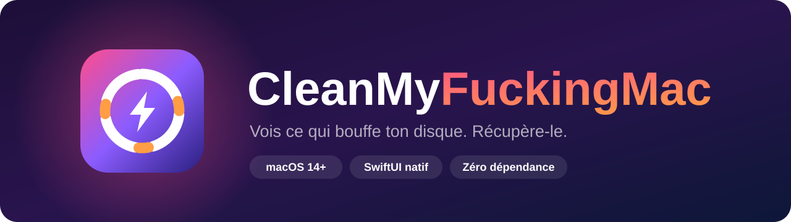
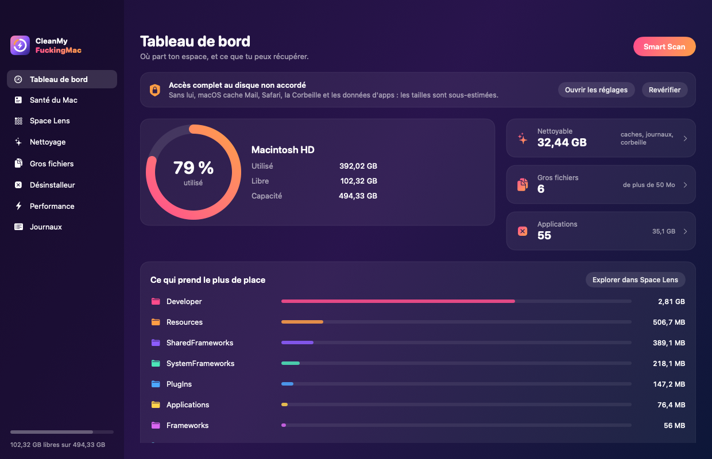

<p align="center">
  
</p>

<p align="center">
  <a href="https://github.com/DamienGdn/cleanMyFuckingMac/actions/workflows/ci.yml"></a>
  <a href="https://github.com/DamienGdn/cleanMyFuckingMac/releases/tag/v1.2.0"></a>
  
  
</p>

Your Mac is full and you don't know why. **CleanMyFuckingMac** shows where the space goes,
tells you what can be deleted safely, and keeps an eye on the machine's health from the menu bar.
Native macOS app in SwiftUI, with no external dependency. English and French, following the Mac's language.

> Personal project inspired by Mac disk cleaners. Not affiliated with CleanMyMac or MacPaw.

<p align="center">
  
  
  
  
</p>

## Features

| Screen | What it does |
|---|---|
| **Dashboard** | Disk gauge, one-click Smart Scan and Smart Clean, biggest folders |
| **Mac Health** | Score out of 100 and KPIs: battery (capacity, cycles, temperature), SSD SMART status, disk space, memory, swap, CPU load, heat, uptime |
| **Space Lens** | Browsable treemap of the disk: the bigger the block, the heavier it is |
| **Cleanup** | App caches, developer caches (uv, npm, pnpm, Bun, Gradle, pub, Cargo, CocoaPods, Xcode), browsers, logs, AI models, Trash |
| **Large Files** | Files of 50 MB and more, filtered by size and age; duplicates detected by content (SHA-256) |
| **Uninstaller** | Removes an app and the data it left in `~/Library`. Protected apps (App Store, installed as root) go through Finder, which shows the Touch ID or password prompt |
| **Performance** | Memory, CPU, network, hungriest apps, programs launched at startup |
| **Logs** | Everything the app did, deletion by deletion |
| **Menu bar** | Quick panel: disk, memory, CPU, network, battery, top apps. Keeps running with the window closed (the icon leaves the Dock, Cmd+Q only closes the window), optional launch at login, alert below 10 GB free |

The interface is in English, or in French when French is the Mac's preferred language
(**System Settings > General > Language & Region**).

## Installation

### From a release

1. Download `CleanMyFuckingMac-1.2.0.zip` from the [Releases](https://github.com/DamienGdn/cleanMyFuckingMac/releases) page.
2. Unzip it and drag the app into `/Applications`.
3. The app is signed locally, not notarized by Apple. On first launch: right-click the app, **Open**.
   If macOS still refuses: `xattr -dr com.apple.quarantine /Applications/CleanMyFuckingMac.app`.

### From source

Requires Xcode 16 or later.

```bash
git clone git@github.com:DamienGdn/cleanMyFuckingMac.git
cd cleanMyFuckingMac
./scripts/build-app.sh               # builds dist/CleanMyFuckingMac.app
open dist/CleanMyFuckingMac.app
```

### Full Disk Access

Without this permission, macOS hides Mail, Safari, the Trash and app data: the sizes shown are
underestimated. Grant it in **System Settings > Privacy & Security > Full Disk Access**
(a banner in the app leads there). A self-built app has to ask for it again after each rebuild.

### Uninstalling protected apps

Some apps (App Store apps, apps installed by a package) belong to the system and cannot be moved by the user
alone. CleanMyFuckingMac then asks Finder to move them to the Trash: macOS asks once for permission to
control Finder, then Finder shows its usual Touch ID or password prompt.

## Deletion safety

A cleaner that wipes the wrong folder is worse than no cleaner. Rules enforced:

- **One door.** Every deletion goes through [`SafeRemover`](Sources/CMFMCore/SafeRemover.swift), which validates the path before acting.
- **Closed perimeter.** Only items inside the home folder, or an `.app` in `/Applications`. Never a root folder (`~/Documents`, `~/Library/Caches`…).
- **Forbidden areas.** Keychains, iCloud Drive, Mail, Messages, `.ssh`, `.gnupg`, `.aws`, `.kube`.
- **Trash by default.** Everything stays recoverable, unless you turn on "Permanent deletion".
- **Confirmation** before each deletion, with the size involved.
- **Traceability.** Every deletion is written to `~/Library/Logs/CleanMyFuckingMac/app.log` (rotated at 2 MB).
- Scans never follow symbolic links and never leave the scanned volume.

## Architecture

```
Sources/
├── CMFMCore/              engine, no UI, covered by tests
│   ├── DiskScanner        size tree, parallel fts traversal
│   ├── Treemap            squarified layout for Space Lens
│   ├── Cleanup            catalog of cleanable categories
│   ├── Duplicates         duplicate detection by hash
│   ├── AppInventory       installed apps and leftover files
│   ├── SystemInfo         disk, memory, CPU, network, battery, processes
│   ├── Health             health KPIs and score
│   ├── SafeRemover        deletion guard
│   └── AppLog             in-memory log + rotating file
├── CleanMyFuckingMac/     SwiftUI app (window + menu bar)
└── cmfm-cli/              command-line engine, read-only
Resources/
└── *.lproj/               translations (English source strings, French table)
```

To add a language, create `Resources/<code>.lproj/Localizable.strings` from the French one,
and add the code to `CFBundleLocalizations` in [`scripts/build-app.sh`](scripts/build-app.sh).

## Development

```bash
swift test                                   # engine tests
swift run cmfm-cli scan ~/Downloads          # command-line scan (read-only)
swift run cmfm-cli clean                     # what could be cleaned, without deleting anything
swift run cmfm-cli apps                      # installed apps by size
```

Automatic screenshots of every screen, without deleting anything (add `-AppleLanguages "(fr)"` for French):

```bash
CMFM_SNAPSHOT_DIR=/tmp/captures CMFM_SNAPSHOT_ROOT=~/Downloads \
  dist/CleanMyFuckingMac.app/Contents/MacOS/CleanMyFuckingMac
```

Tests run on GitHub Actions on every push and pull request ([workflow](.github/workflows/ci.yml)).

## Version 1.2.0

Details in the [CHANGELOG](CHANGELOG.md).

- **Configurable menu bar**: up to 3 values of your choice (CPU, RAM, free disk, ↓/↑ throughput, battery), in compact format. Set it in the panel.
- **Smart Clean**: cleans safe caches and logs in one click, after confirmation. Never touches the Trash or AI models.
- **Real service**: with the window closed, the icon leaves the Dock and the app keeps running in the menu bar. Cmd+Q only closes the window; to stop everything, **Quit** in the menu bar panel.
- **Version shown** in the sidebar and the panel, taken from the git tag at build time.
- The nine screens above, with logo, splash screen and dark theme.
- Menu bar service with low-disk alert.
- Full scan of a 2.7-million-file home folder in about twenty seconds (Apple silicon Mac).

### Not there yet

- Anti-malware
- Third-party app updates
- File shredder
- Privacy cleanup (browser history and cookies)
- Apple notarization
