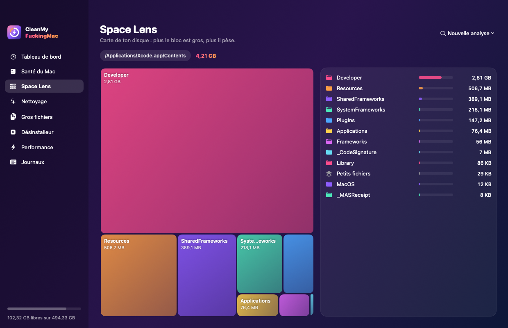
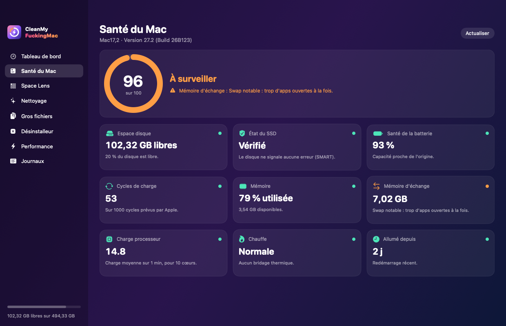
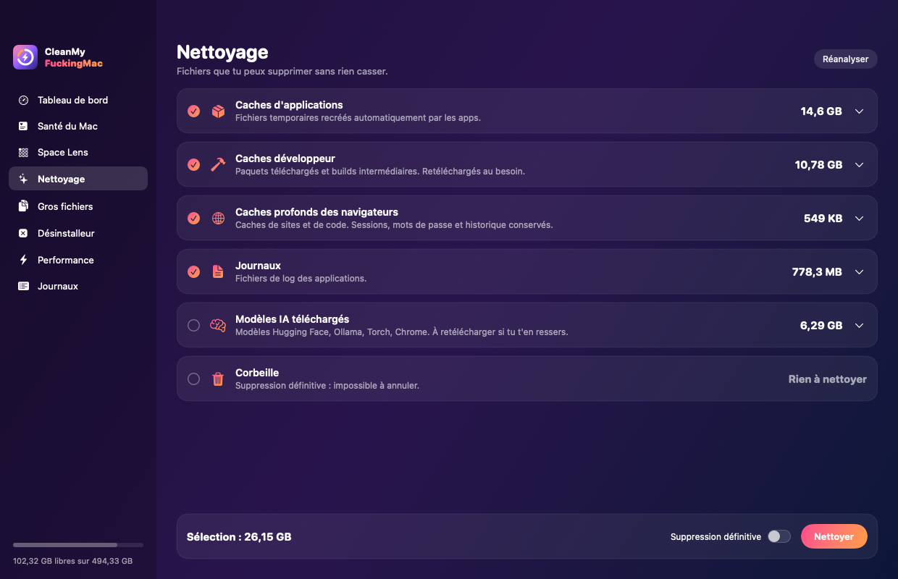

<p align="center">
  
</p>

<p align="center">
  <a href="https://github.com/DamienGdn/cleanMyFuckingMac/actions/workflows/ci.yml"></a>
  <a href="https://github.com/DamienGdn/cleanMyFuckingMac/releases/tag/v1.1.0"></a>
  
  
</p>

Ton Mac est plein et tu ne sais pas pourquoi. **CleanMyFuckingMac** te montre où part l'espace,
te dit ce qui se supprime sans risque, et surveille la santé de la machine depuis la barre de menus.
App macOS native en SwiftUI, sans aucune dépendance externe.

> Projet personnel inspiré des nettoyeurs de disque pour Mac. Aucun lien avec CleanMyMac ni MacPaw.

<p align="center">
  
  
  
  
</p>

## Fonctionnalités

| Écran | Ce qu'il fait |
|---|---|
| **Tableau de bord** | Jauge disque, Smart Scan et Smart Clean en un clic, plus gros dossiers |
| **Santé du Mac** | Score sur 100 et KPI : batterie (capacité, cycles, température), SMART du SSD, espace, mémoire, swap, charge, chauffe, uptime |
| **Space Lens** | Carte (treemap) navigable du disque : plus le bloc est gros, plus il pèse |
| **Nettoyage** | Caches d'apps, caches développeur (uv, npm, pnpm, Bun, Gradle, pub, Cargo, CocoaPods, Xcode), navigateurs, journaux, modèles IA, Corbeille |
| **Gros fichiers** | Fichiers de 50 Mo et plus, filtrables par taille et âge ; doublons détectés par contenu (SHA-256) |
| **Désinstalleur** | Supprime une app et les données qu'elle a laissées dans `~/Library` |
| **Performance** | Mémoire, processeur, réseau, apps les plus gourmandes, programmes lancés au démarrage |
| **Journaux** | Tout ce que l'app a fait, suppression par suppression |
| **Barre de menus** | Panneau rapide : disque, mémoire, CPU, réseau, batterie, top des apps. Reste actif fenêtre fermée (l'icône quitte le Dock, Cmd+Q ne ferme que la fenêtre), lancement à l'ouverture de session en option, alerte sous 10 Go libres |

## Installation

### Depuis une release

1. Télécharge `CleanMyFuckingMac-1.1.0.zip` sur la page [Releases](https://github.com/DamienGdn/cleanMyFuckingMac/releases).
2. Dézippe et glisse l'app dans `/Applications`.
3. L'app est signée localement, pas notarisée par Apple. Au premier lancement : clic droit sur l'app, **Ouvrir**.
   Si macOS refuse encore : `xattr -dr com.apple.quarantine /Applications/CleanMyFuckingMac.app`.

### Depuis les sources

Il faut Xcode 16 ou plus récent.

```bash
git clone git@github.com:DamienGdn/cleanMyFuckingMac.git
cd cleanMyFuckingMac
./scripts/build-app.sh               # produit dist/CleanMyFuckingMac.app
open dist/CleanMyFuckingMac.app
```

### Accès complet au disque

Sans cette autorisation, macOS cache Mail, Safari, la Corbeille et les données d'apps : les tailles affichées
sont sous-estimées. Accorde-la dans **Réglages Système > Confidentialité et sécurité > Accès complet au disque**
(un bandeau dans l'app y mène). Une app compilée soi-même doit la redemander après chaque recompilation.

## Sécurité des suppressions

Un nettoyeur qui efface le mauvais dossier est pire que pas de nettoyeur. Règles appliquées :

- **Une seule porte.** Toute suppression passe par [`SafeRemover`](Sources/CMFMCore/SafeRemover.swift), qui valide le chemin avant d'agir.
- **Périmètre fermé.** Uniquement des éléments à l'intérieur du dossier personnel, ou une `.app` de `/Applications`. Jamais un dossier racine (`~/Documents`, `~/Library/Caches`…).
- **Zones interdites.** Trousseaux, iCloud Drive, Mail, Messages, `.ssh`, `.gnupg`, `.aws`, `.kube`.
- **Corbeille par défaut.** Tout reste récupérable, sauf si tu actives « Suppression définitive ».
- **Confirmation** avant chaque suppression, avec la taille concernée.
- **Traçabilité.** Chaque suppression est écrite dans `~/Library/Logs/CleanMyFuckingMac/app.log` (rotation à 2 Mo).
- L'analyse ne suit jamais les liens symboliques et ne sort jamais du volume analysé.

## Architecture

```
Sources/
├── CMFMCore/              moteur, sans interface, couvert par les tests
│   ├── DiskScanner        arbre des tailles, parcours fts parallèle
│   ├── Treemap            disposition « squarified » pour Space Lens
│   ├── Cleanup            catalogue des catégories nettoyables
│   ├── Duplicates         détection de doublons par empreinte
│   ├── AppInventory       apps installées et fichiers résiduels
│   ├── SystemInfo         disque, mémoire, CPU, réseau, batterie, processus
│   ├── Health             KPI et score de santé
│   ├── SafeRemover        garde-fou des suppressions
│   └── AppLog             journal en mémoire + fichier rotatif
├── CleanMyFuckingMac/     application SwiftUI (fenêtre + barre de menus)
└── cmfm-cli/              moteur en ligne de commande, lecture seule
```

## Développement

```bash
swift test                                   # tests du moteur
swift run cmfm-cli scan ~/Downloads          # analyse en ligne de commande (lecture seule)
swift run cmfm-cli clean                     # ce qui serait nettoyable, sans rien supprimer
swift run cmfm-cli apps                      # apps installées par taille
```

Captures d'écran automatiques de tous les écrans, sans rien supprimer :

```bash
CMFM_SNAPSHOT_DIR=/tmp/captures CMFM_SNAPSHOT_ROOT=~/Downloads \
  dist/CleanMyFuckingMac.app/Contents/MacOS/CleanMyFuckingMac
```

Les tests tournent sur GitHub Actions à chaque push et pull request ([workflow](.github/workflows/ci.yml)).

## Version 1.1.0

Détail dans le [CHANGELOG](CHANGELOG.md).

- **Smart Clean** : nettoie en un clic les caches et journaux sans risque, après confirmation. Ne touche jamais à la Corbeille ni aux modèles IA.
- **Vrai service** : fenêtre fermée, l'icône quitte le Dock et l'app continue dans la barre de menus. Cmd+Q ne ferme que la fenêtre ; pour tout arrêter, **Quitter** dans le panneau de la barre de menus.
- **Version affichée** dans la barre latérale et le panneau, tirée du tag git au build.

- Les neuf écrans ci-dessus, avec logo, écran de démarrage et thème sombre.
- Service en barre de menus avec alerte disque faible.
- Analyse complète d'un dossier personnel de 2,7 millions de fichiers en une vingtaine de secondes (Mac Apple silicon).

### Pas encore là

- Antimalware
- Mise à jour des apps tierces
- Destructeur de fichiers
- Nettoyage de la vie privée (historique et cookies des navigateurs)
- Notarisation Apple
